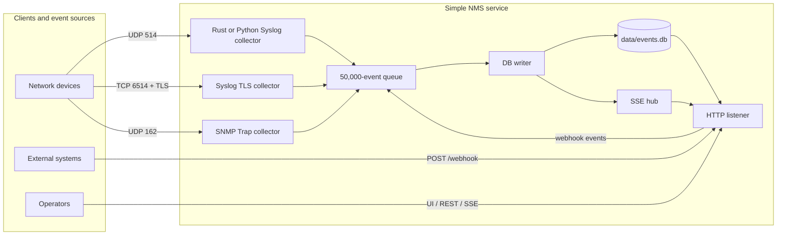

# Installation Guide

## Prerequisites

- **Python 3.10+** (Debian 12 ships with 3.11)
- **Rust/Cargo** — required only for the default Rust UDP Syslog collector (the installer offers Rust or Python)
- **pip** (Python package manager)
- **snmptrap** for local SNMP testing (`snmp` on Debian/Ubuntu, `net-snmp-utils` on RHEL/CentOS)
- No external database, web server, or message broker required

## Deployment Architecture

Simple NMS uses the Python UDP Syslog collector or, by default, starts a local Rust
collector for high-volume UDP Syslog. Choose which ports are reachable at the host
firewall or reverse proxy; they are not separate deployable services.



| Port | Protocol | Purpose | Typical exposure |
|------|----------|---------|------------------|
| 80 | TCP/HTTP | Dashboard, REST API, Settings, SSE, webhook | Management network or authenticated reverse proxy |
| 514 | UDP | Plain Syslog input | Network devices only |
| 162 | UDP | SNMP Trap input | Network devices only |
| 6514 | TCP/TLS | Optional encrypted Syslog input | Network devices only |

The HTTP surface has no built-in authentication and includes configuration,
certificate upload, MIB management, and event deletion. Do not expose it directly
to an untrusted network. For a reverse-proxy deployment, bind Simple NMS to
`127.0.0.1:5000` and enforce authentication and TLS at the proxy.

The only persistent runtime directory is `data/`: it contains the SQLite database,
the Web UI configuration overlay, uploaded TLS files, and custom MIBs. Back up the
whole directory rather than only `events.db` if you need a complete restore.

## Supported deployment: systemd on Linux

### 1. Run the installer

```bash
sudo ./scripts/install.sh
```

The installer asks for the UDP Syslog collector (`rust` or `python`), web portal TCP port (1–65535, default: existing setting or 80), and SNMP Trap community, creates the `simplenms` user, copies the app to `/opt/simple-nms`, creates a virtualenv, installs Python dependencies, installs the systemd unit, and starts the service. The web portal and webhook share the selected port. Rust is the default; when selected, the installer downloads Cargo/Rust if needed, compiles and deploys the collector, then removes its build artifacts and offers to remove only build packages it installed.

On reinstall, the installer updates the active configuration (including a saved data-directory override) and restarts the service to apply the selected port. This briefly interrupts collection and web access.

### 2. Manual install

```bash
sudo useradd -r -m -d /opt/simple-nms -s /usr/sbin/nologin simplenms
sudo mkdir -p /opt/simple-nms/data /opt/simple-nms/scripts
sudo cp -r src/simplenms/* requirements.txt config.example.json /opt/simple-nms/
# Only when syslog.collector is "rust"
sudo cargo build --release --manifest-path rust-syslog/Cargo.toml
sudo cp rust-syslog/target/release/simplenms-syslog /opt/simple-nms/
sudo cargo clean --manifest-path rust-syslog/Cargo.toml
sudo python3 -m venv /opt/simple-nms/venv
sudo /opt/simple-nms/venv/bin/pip install -r /opt/simple-nms/requirements.txt
sudo chown -R root:simplenms /opt/simple-nms
sudo chown -R simplenms:simplenms /opt/simple-nms/data
```

Dependencies installed:
| Package | Purpose |
|---------|---------|
| `flask` | Web server, API, webhook, UI, and WSGI stack |
| `pysnmp` | SNMP Trap receiver |
| `pysmi` | ASN.1 MIB compiler used by pysnmp |

Standard library (no install needed): `sqlite3`, `socket`, `queue`, `threading`, `json`.

### 3. Configure

Copy the example config and edit `/opt/simple-nms/config.json`:

```bash
sudo cp /opt/simple-nms/config.example.json /opt/simple-nms/config.json
sudo nano /opt/simple-nms/config.json
```

```json
{
    "database": {
        "path": "data/events.db"
    },
    "writer": {
        "batch_size": 100,
        "flush_interval_ms": 200
    },
    "syslog": {
        "enabled": true,
        "collector": "rust",
        "host": "0.0.0.0",
        "port": 514,
        "deny_ips": []
    },
    "syslog_tls": {
        "enabled": false,
        "host": "0.0.0.0",
        "port": 6514,
        "certfile": "data/tls/server.crt",
        "keyfile": "data/tls/server.key",
        "require_client_cert": false
    },
    "snmptrap": {
        "enabled": true,
        "host": "0.0.0.0",
        "port": 162,
        "community": "simplenms",
        "mib_dirs": ["/opt/simple-nms/data/mibs", "/usr/share/snmp/mibs"]
    },
    "webhook": {
        "enabled": true,
        "host": "0.0.0.0",
        "port": 80
    }
}
```

### Syslog TLS (RFC 5425)

Use the Web UI **Settings → Syslog TLS** card to upload the server certificate and private key, then choose **Apply TLS changes**. The listener starts or reloads immediately on TCP 6514 and disconnects active TLS clients. For mTLS, upload a CA certificate and enable **Require client certificate** before applying. The uploaded files are stored in `/opt/simple-nms/data/tls/`; keep this directory readable only by the service user.

The **Service** card saves SNMP community and Web/Webhook settings separately. Changing the Web/Webhook port requires a service restart; TLS changes do not.

### UDP Syslog collector

`syslog.collector` selects the UDP listener: `rust` is the default for high-rate traffic and runs as a local child process; `python` uses the in-process collector and does not require Cargo. Select it during `scripts/install.sh`, or update the setting and restart `simple-nms`. Syslog TLS remains Python-based.

### Syslog source denylist

Use **Settings → Syslog source denylist** to enter one complete IPv4 or IPv6 address per line. Saving validates and immediately applies the list to both UDP and TLS collectors without restarting the service. Matching sources are dropped before parsing and storage. Clear the field and save to allow all sources again.

The same setting is stored in `syslog.deny_ips`:

```json
"syslog": {
    "enabled": true,
    "collector": "rust",
    "host": "0.0.0.0",
    "port": 514,
    "deny_ips": ["192.0.2.10", "2001:db8::10"]
}
```

If Simple NMS is behind HAProxy on the same host, bind the web server to loopback and use a non-public backend port:

```json
    "webhook": {
        "enabled": true,
        "host": "127.0.0.1",
        "port": 5000
    }
```

### 4. Create data directory

```bash
sudo -u simplenms mkdir -p /opt/simple-nms/data
```

### 5. Install systemd service

```bash
sudo cp deploy/simple-nms.service /etc/systemd/system/
sudo systemctl daemon-reload
sudo systemctl enable simple-nms
sudo systemctl start simple-nms
```

The systemd unit uses `AmbientCapabilities=CAP_NET_BIND_SERVICE` so the service can bind to ports 80, 162, and 514 without running as root.

### 6. Verify

```bash
# Check service status
sudo systemctl status simple-nms

# Check logs
sudo journalctl -u simple-nms -f

# Test web UI
curl -s http://localhost/health

# Verify Web UI community updates reach the running SNMP trap listener
./scripts/check_community_update.py --base-url http://127.0.0.1 --trap-host 127.0.0.1 --trap-port 162 --restore
```

Open `http://your-server` in a browser to see the dashboard.

### 7. Data retention (optional)

For manual cleanup, use **Clear Old Events** in the Web UI or call the API:

```bash
curl -X POST http://localhost/api/events/cleanup \
  -H "Content-Type: application/json" \
  -d '{"before_ts":"2026-01-01T00:00:00"}'
```

For unattended cleanup, call the API from cron:

```bash
sudo crontab -u simplenms -e
```

Add:

```cron
0 3 * * * curl -fsS -X POST http://localhost/api/events/cleanup -H "Content-Type: application/json" -d "{\"before_ts\":\"$(date -u -d '30 days ago' +\\%Y-\\%m-\\%dT\\%H:\\%M:\\%S)\"}"
```

### 8. Firewall

If using UFW:

```bash
sudo ufw allow 80/tcp     # Web UI + Webhook
sudo ufw allow 514/udp    # Syslog
sudo ufw allow 6514/tcp   # Syslog TLS (RFC 5425), if enabled
sudo ufw allow 162/udp    # SNMP Trap
```

For production, restrict UDP ports to your internal network:

```bash
sudo ufw allow from 10.0.0.0/8 to any port 514 proto udp
sudo ufw allow from 10.0.0.0/8 to any port 162 proto udp
```

### 9. Local HAProxy reverse proxy (optional)

When HAProxy runs on the same host, expose HAProxy on port 80/443 and forward to the loopback Simple NMS backend:

```haproxy
frontend http_in
    bind *:80
    mode http
    default_backend simple_nms

backend simple_nms
    mode http
    option forwardfor
    http-request set-header X-Forwarded-Proto http
    server simple_nms_1 127.0.0.1:5000 check
```

Simple NMS trusts `X-Forwarded-For` and `X-Real-IP` only when the immediate peer is loopback. This supports local HAProxy while preventing direct clients from spoofing webhook `src_ip`.

---

## Manual Start (development / testing)

For testing on non-privileged ports without root:

```bash
# Copy config.example.json to config.json and set ports to 8080 (webhook), 5514 (syslog), 1162 (snmptrap)
cargo build --release --manifest-path rust-syslog/Cargo.toml
cd src/simplenms
python3 main.py ../../config.json
```

---

## Troubleshooting

| Problem | Solution |
|---------|----------|
| `Permission denied` on port 80/514/162 | Use systemd service (has `AmbientCapabilities`), or run `sudo setcap cap_net_bind_service=+ep $(which python3)` |
| `Address already in use` on port 80 | Stop nginx/apache: `sudo systemctl stop nginx` |
| `ModuleNotFoundError: pysnmp` | Run `pip install pysnmp --break-system-packages` |
| Community change in Web UI does not affect traps | Run `scripts/check_community_update.py`; verify the service is running current code and `snmptrap` is installed |
| Events not appearing in UI | Check browser console for SSE errors; verify with `curl http://localhost/api/kpi` |
| Database locked errors | SQLite is always run in WAL mode; check for another process holding a write lock on the `.db` file |
